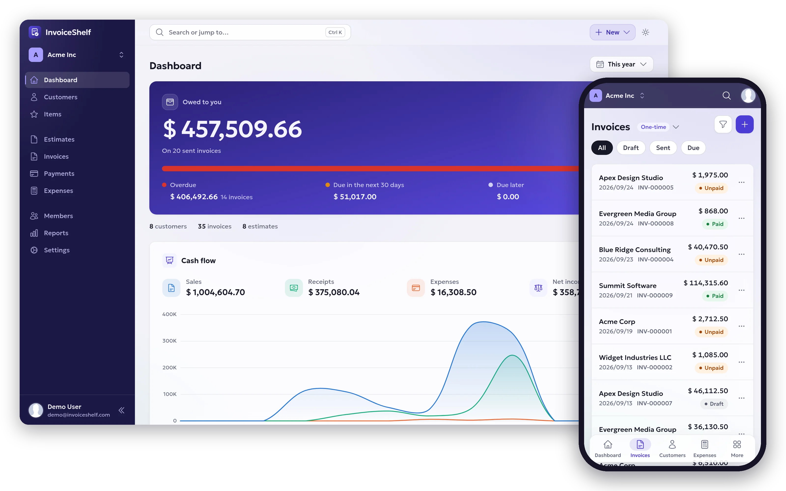

  <picture>
    <source media="(prefers-color-scheme: dark)" srcset="assets/logo-dark.svg">
    
  </picture>

<h3 align="center">Open-source invoicing you host yourself</h3>

  Invoices, estimates, payments and expenses for freelancers and small businesses, 
  on your own server, with your customers' data staying where you put it.

  <a href="https://invoiceshelf.com"><strong>Website</strong></a> ·
  <a href="https://invoiceshelf.com/download">Download</a> ·
  <a href="https://docs.invoiceshelf.com">Documentation</a> ·
  <a href="https://discord.gg/eHXf4zWhsR">Discord</a>

 

  <picture>
    <source media="(prefers-color-scheme: dark)" srcset="assets/hero-dark.webp">
    
  </picture>

## Start here

| Repository | What it is |
| --- | --- |
| [**InvoiceShelf**](https://github.com/InvoiceShelf/InvoiceShelf) | The application. `2.x` is the stable line and gets security fixes until September 2027. `3.x` is the next major version, now in public alpha: redesigned to work on a phone as well as a desktop, with modules, and with AI assistants that connect over MCP. |
| [**docker**](https://github.com/InvoiceShelf/docker) | Docker Compose setups for SQLite, MySQL and PostgreSQL. |
| [**docs**](https://github.com/InvoiceShelf/docs) | The guides at [docs.invoiceshelf.com](https://docs.invoiceshelf.com). |
| [**api-docs**](https://github.com/InvoiceShelf/api-docs) | The 3.x REST API reference at [api-docs.invoiceshelf.com](https://api-docs.invoiceshelf.com). |

## Modules for 3.x

Modules add features without making the core heavier. Official modules are free and install from the marketplace inside InvoiceShelf.

| Module | What it does |
| --- | --- |
| [**Tasks and Projects**](https://github.com/InvoiceShelf/module-tasks-projects) | Projects, tasks, a Kanban board and time tracking, with invoices raised straight from tracked time. |
| [**AI Assistant**](https://github.com/InvoiceShelf/module-ai-assistant) | An in-app assistant and writing tools, on an OpenRouter key you provide. |
| [**Hello World**](https://github.com/InvoiceShelf/module-helloworld) | The reference module to start your own from. |
| [**modules**](https://github.com/InvoiceShelf/modules) | The SDK modules are built on: manifests, host contracts and signed releases. |

## Get involved

- Report a bug or suggest a feature in [InvoiceShelf's issues](https://github.com/InvoiceShelf/InvoiceShelf/issues).
- Translate InvoiceShelf into your language at [translate.invoiceshelf.com](https://translate.invoiceshelf.com).
- Ask questions and share what you are building on [Discord](https://discord.gg/eHXf4zWhsR).
- Help fund its maintenance through [GitHub Sponsors](https://github.com/sponsors/InvoiceShelf). It is optional, and InvoiceShelf stays free either way.
- Found a security problem? Report it privately through a [security advisory](https://github.com/InvoiceShelf/InvoiceShelf/security/advisories/new), not in a public issue.
